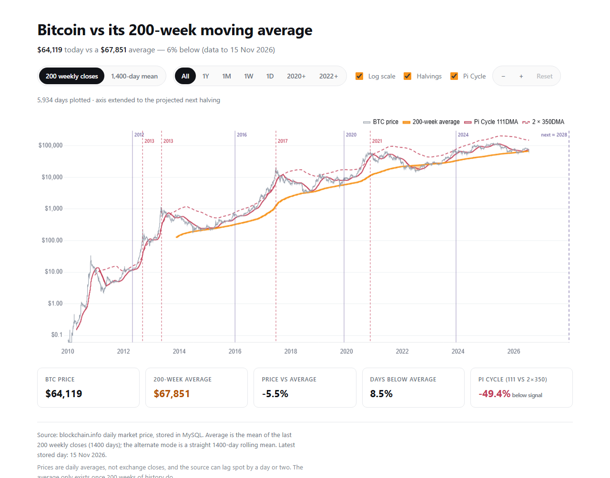

# Bitcoin vs its 200-week moving average

A small, self-contained web app that charts the bitcoin price against its
200-week moving average. PHP + MySQL on the server, Chart.js in the browser,
no frameworks and no build step.



## What it does

- Imports the full daily bitcoin price history into MySQL (`bin/import.php`)
- Computes the 200-week average on request (`/api/series.php`)
- Renders price and average together, shading the stretches where price traded
  **below** the average
- Marks every bitcoin halving with a vertical line, and projects the next one
  from the current chain height
- Lets you switch between the two common definitions of the average, pick a
  timeframe (1D / 1W / 1M / 1Y / all, or from a given year), and toggle log/linear
  scaling
- Zooms and pans: wheel or pinch to zoom, drag to pan, double-click or press
  `0` to reset (see [Zooming](#zooming))
- Overlays the Pi Cycle Top indicator — 111DMA against 2 × 350DMA — with the
  historical crossings marked (see [Pi Cycle Top](#pi-cycle-top))

## Zooming

Wheel, pinch, or the `+` / `−` buttons zoom the x-axis; drag pans; double-click,
the **Reset** button, or the `0` key returns to the full range. With the canvas
focused, `+`/`−` zoom and the arrow keys pan.

Zooming moves a window over the data already in the browser. It does not
refetch, so a wheel gesture costs one canvas redraw and one database query is
saved. The y-axis rescales to whatever is visible — on a log scale over 13
years, a three-month window would otherwise be two flat lines in the middle of
a lot of empty space.

Two details worth knowing:

* **The series is sliced, not masked.** Handing the chart a shorter array keeps
  its category axis, tooltips and halving markers in agreement. Setting a
  min/max on a category axis does not mean "data index", and the tick labels
  quietly describe the wrong years.
* **The zoom belongs to the loaded range.** Changing mode or timeframe loads a
  different series and resets to unzoomed; toggling log scale keeps the window,
  since only the y-axis changes.

A 1D window is a single point and refuses to zoom, rather than collapsing the
axis to nothing.

## Requirements

- PHP 8.1+ with `pdo_mysql`
- MySQL 5.7+ / MariaDB 10.3+
- A modern browser (Chart.js is loaded from a CDN, so the page needs network
  access on first load)

Tested on PHP 8.5 and MariaDB 10.4.

## Setup

```bash
git clone <this repo> btc-200wma
cd btc-200wma

# 1. configuration
cp config/config.sample.php config/config.php
#    edit the db credentials in config.php

# 2. schema
mysql -u root -p < database/schema.sql

# 3. price history (~6,500 days, one HTTP request)
php bin/import.php

# 4. serve
php -S localhost:8000 -t public
```

Then open <http://localhost:8000>.

The view is also linkable: `?range=year` or `?mode=daily` open straight into
that selection.

If you use Apache or nginx instead, point the document root at `public/`. The
only PHP files served directly are `public/index.php` and
`public/api/series.php`; everything else lives outside the web root.

## Layout

```
bin/import.php              CLI: fetch history into MySQL
config/config.sample.php    copy to config.php (git-ignored)
database/schema.sql          tables: prices, import_runs
public/index.php            the page
public/api/series.php       JSON: dates, prices, average, stats
public/js/app.js            Chart.js rendering + controls
public/css/style.css        styling
src/App.php                 config + autoloader + factories
src/Database.php            PDO connection
src/PriceRepository.php     queries and upserts
src/MovingAverage.php       the average itself
src/Importer.php            download, normalise, store
tests/MovingAverageTest.php plain-PHP tests for the average
tests/PiCycleTest.php       plain-PHP tests for the Pi Cycle indicator
```

## The 200-week average: which definition?

There are two, and they are not identical. Both are supported because the
difference is big enough to quote the wrong number if you are not explicit.

**Weekly closes (default).** The canonical definition: take the price at the
end of each week, average the last 200 of those closes. This is what most
charts showing "200W MA" use.

**Daily window (`?mode=daily`).** A straight rolling mean over the last
1,400 calendar days.

On the same data these differ by roughly 0.1%. That is small, but it is not
rounding — it is a genuinely different statistic.

Two details worth knowing:

* **A week runs Monday to Sunday**, and its close is Sunday's price. An
  unfinished trailing week is not a close, so it is excluded.
* **Each week's average is drawn across the days of that week.** This means the
  plotted line "knows" Sunday's close for up to six days before Sunday arrives.
  Over a 1,400-day window that lookahead is negligible, but it is a real
  property of the line, not an accident.

`tests/MovingAverageTest.php` pins both behaviours down.

## Data source

[blockchain.info](https://api.blockchain.info/charts/market-price) public chart
API — no key required. One point per day.

Because the source is daily, the 1D timeframe is a single observation — the
latest stored day — not an intraday session. There is no finer granularity in
this dataset.

Two things this imposes on the chart:

* It reports a **daily average price**, not an exchange close. Differences from
  a close-based series are small at this scale but non-zero.
* History begins in 2010 with a run of zeros before the first real print. Zeros
  are "no data", not "$0", so the importer drops them. The average therefore
  only exists from mid-2014 onward, once 200 weeks of history do.

The importer verifies that the series contains exactly one row per calendar day
before storing anything, and forward-fills any missing day, so the rolling
window counts days rather than observations.

The source can lag spot by a day or two. The page shows the latest stored day
so this is visible rather than assumed.

## Pi Cycle Top

A second overlay, toggled by **Pi Cycle** (on by default). Two lines:

* **111-day simple moving average**, and
* **2 × the 350-day simple moving average**.

When the 111DMA rises through 2 × the 350DMA, that crossing has historically
coincided with a cycle high. The name comes from 350 / 111 = 3.153, the closest
you can get to pi by dividing 350 by a whole number.

Two things are easy to get wrong, and both are pinned by
`tests/PiCycleTest.php`:

* **The multiple is of the price, not the days.** 2 × 350DMA means twice the
  average *price*; it is not a 700-day average.
* **The signal is a crossing, not a level.** Sitting above is the after-effect;
  the event is the day it moved from at-or-below to above. Touching and then
  rising counts.

On the stored history this yields four crossings — 2013-04-07, 2013-12-07,
2017-12-17 and 2021-04-13 — each within three days of a local price peak, which
is what the indicator claims for itself. They are drawn as dashed vertical
markers, offset to a second line at the top so they cannot collide with the
halving labels.

Definition taken from the indicator's published description
(<https://www.lookintobitcoin.com/charts/pi-cycle-top-indicator/>, retrieved
2026-11-16). The Pi Cycle *Bottom* variant is deliberately absent: its periods
could not be confirmed from a primary source, and guessing them would produce a
plausible-looking chart that is simply wrong.

## Halvings

Vertical markers, drawn by a small custom Chart.js plugin (no extra dependency).

Past halvings are facts, taken from the timestamp of the first block of each
reward era:

| Block     | Date (UTC)          |
|-----------|---------------------|
| 210,000   | 2012-11-28 15:24    |
| 420,000   | 2016-07-09 16:46    |
| 630,000   | 2020-05-11 19:23    |
| 840,000   | 2024-04-20 00:09    |

Note the 2024 date is the **20th** in UTC — it is often quoted as the 19th
because that is the local date in US timezones.

**The next halving is a projection, not a fact.** It happens at block 1,050,000,
and the date depends on how quickly blocks are found. `bin/import.php` reads the
current height and stores it; the projection is current height plus the
remaining blocks at 600 seconds each, marked as an estimate and drawn dashed.

Two consequences worth knowing:

* The next halving is always in the future, so it falls outside the price data.
  The chart appends empty days to the x-axis to give it a place to sit — but
  only when that adds at most half the current span. On a 1W view, padding 18
  months of empty axis would squash the week to a sliver, so the marker is left
  out and the status line says it is out of range.
* Re-run the import to refresh the projection. It drifts as the block rate
  changes; nothing pretends otherwise.

## API

`GET /api/series.php`

| Parameter | Values                          | Default  | Meaning                          |
|-----------|---------------------------------|----------|----------------------------------|
| `mode`    | `weekly`, `daily`               | `weekly` | average definition               |
| `range`   | `day`, `week`, `month`, `year`  | all      | last 1 / 7 / 30 / 365 days       |
| `since`   | year, e.g. `2020`               | all      | trim from that calendar year     |

The `halvings` array in the response is never windowed — the client decides
which markers fall inside the visible range.

`range` is measured back from the **last stored day**, not from today. The
source can lag, and anchoring to "now" would leave a gap at the right edge of
the chart. If both `range` and `since` are supplied, `range` wins.

Response:

```json
{
  "mode": "weekly",
  "weeks": 200,
  "from": "2014-06-09",
  "to": "2026-11-03",
  "labels": ["2010-08-18", "..."],
  "price": [0.07, "..."],
  "ma": [null, "...", 67341.31],
  "stats": { "price": 76675.03, "ma": 67341.31, "ratio": 1.1386,
             "below_pct": 8.47, "points": 4531 }
}
```

`ma` is `null` for every day before 200 weeks of history exist. The client is
expected to break the line there rather than plot a zero.

`stats` always describes the whole series, not the zoomed window, so the
headline number does not change when you zoom.

The `pi` object carries the Pi Cycle overlay: `fast` and `slow` arrays aligned
with `labels` (null until enough history exists), `crosses` as a list of ISO
dates for every historical 111DMA-over-2×350DMA crossing, plus `fast_now`,
`slow_now` and `gap_pct` for the latest day. Like `halvings`, `crosses` is not
windowed — the client decides which markers fall inside the visible range.

## Refreshing the data

`bin/import.php` is idempotent — rows are upserted by date, so re-running only
refreshes recent values and fills new days. Run it from cron:

```
15 3 * * * cd /path/to/btc-200wma && php bin/import.php >/dev/null 2>&1
```

Each run is recorded in `import_runs` with row counts and status.

### Windows: run it daily

`setup_daily_import.ps1` registers a Scheduled Task that runs the import every
night at 03:15 and catches up on the next boot if the machine was off:

```
powershell -ExecutionPolicy Bypass -File setup_daily_import.ps1
```

It runs as `SYSTEM`, so no stored password is needed. Remove it with:

```
Unregister-ScheduledTask -TaskName 'btc-200wma daily import' -Confirm:$false
```

The page always states how far the data goes (`Latest stored day: …`) rather
than implying it is current, so a stale import is visible instead of silent.

## Tests

```bash
php tests/MovingAverageTest.php
php tests/HalvingsTest.php
php tests/PiCycleTest.php
```

17 assertions on week alignment, exclusion of the partial trailing week, and
both averaging modes; 20 on the halving schedule and projection; 14 on the Pi
Cycle windows, the price multiple and crossing detection. No dependencies.

## Limitations

- Single-user, read-only view. There is no authentication and nothing to
  protect, but do not put it behind anything that assumes otherwise.
- Prices are daily averages from one source, not a consolidated feed.
- The chart loads Chart.js from a CDN; the app is not fully self-hosted.
- No historical storage of the computed average — it is recalculated per
  request (about 6,000 rows, so this is fast).

## Licence

MIT
