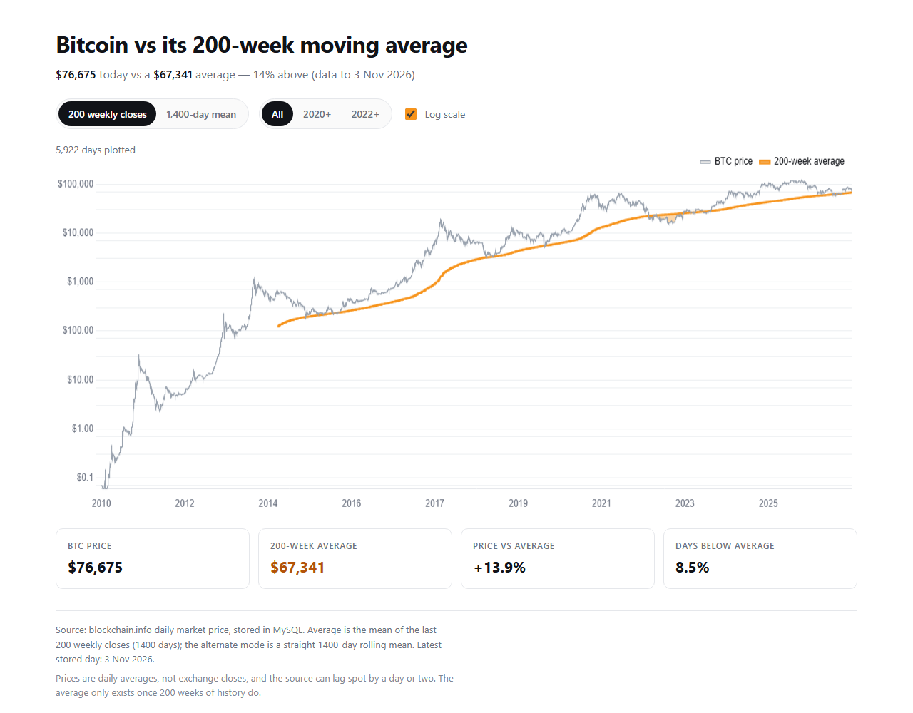

# Bitcoin vs its 200-week moving average

A small, self-contained web app that charts the bitcoin price against its
200-week moving average. PHP + MySQL on the server, Chart.js in the browser,
no frameworks and no build step.



## What it does

- Imports the full daily bitcoin price history into MySQL (`bin/import.php`)
- Computes the 200-week average on request (`/api/series.php`)
- Renders price and average together, shading the stretches where price traded
  **below** the average
- Lets you switch between the two common definitions of the average, zoom the
  time range, and toggle log/linear scaling

## Requirements

- PHP 8.1+ with `pdo_mysql`
- MySQL 5.7+ / MariaDB 10.3+
- A modern browser (Chart.js is loaded from a CDN, so the page needs network
  access on first load)

Tested on PHP 8.5 and MariaDB 10.4.

## Setup

```bash
git clone <this repo> btc-200wma
cd btc-200wma

# 1. configuration
cp config/config.sample.php config/config.php
#    edit the db credentials in config.php

# 2. schema
mysql -u root -p < database/schema.sql

# 3. price history (~6,500 days, one HTTP request)
php bin/import.php

# 4. serve
php -S localhost:8000 -t public
```

Then open <http://localhost:8000>.

If you use Apache or nginx instead, point the document root at `public/`. The
only PHP files served directly are `public/index.php` and
`public/api/series.php`; everything else lives outside the web root.

## Layout

```
bin/import.php              CLI: fetch history into MySQL
config/config.sample.php    copy to config.php (git-ignored)
database/schema.sql          tables: prices, import_runs
public/index.php            the page
public/api/series.php       JSON: dates, prices, average, stats
public/js/app.js            Chart.js rendering + controls
public/css/style.css        styling
src/App.php                 config + autoloader + factories
src/Database.php            PDO connection
src/PriceRepository.php     queries and upserts
src/MovingAverage.php       the average itself
src/Importer.php            download, normalise, store
tests/MovingAverageTest.php plain-PHP tests for the average
```

## The 200-week average: which definition?

There are two, and they are not identical. Both are supported because the
difference is big enough to quote the wrong number if you are not explicit.

**Weekly closes (default).** The canonical definition: take the price at the
end of each week, average the last 200 of those closes. This is what most
charts showing "200W MA" use.

**Daily window (`?mode=daily`).** A straight rolling mean over the last
1,400 calendar days.

On the same data these differ by roughly 0.1%. That is small, but it is not
rounding — it is a genuinely different statistic.

Two details worth knowing:

* **A week runs Monday to Sunday**, and its close is Sunday's price. An
  unfinished trailing week is not a close, so it is excluded.
* **Each week's average is drawn across the days of that week.** This means the
  plotted line "knows" Sunday's close for up to six days before Sunday arrives.
  Over a 1,400-day window that lookahead is negligible, but it is a real
  property of the line, not an accident.

`tests/MovingAverageTest.php` pins both behaviours down.

## Data source

[blockchain.info](https://api.blockchain.info/charts/market-price) public chart
API — no key required. One point per day.

Two things this imposes on the chart:

* It reports a **daily average price**, not an exchange close. Differences from
  a close-based series are small at this scale but non-zero.
* History begins in 2010 with a run of zeros before the first real print. Zeros
  are "no data", not "$0", so the importer drops them. The average therefore
  only exists from mid-2014 onward, once 200 weeks of history do.

The importer verifies that the series contains exactly one row per calendar day
before storing anything, and forward-fills any missing day, so the rolling
window counts days rather than observations.

The source can lag spot by a day or two. The page shows the latest stored day
so this is visible rather than assumed.

## API

`GET /api/series.php`

| Parameter | Values            | Default  | Meaning                          |
|-----------|-------------------|----------|----------------------------------|
| `mode`    | `weekly`, `daily` | `weekly` | average definition               |
| `since`   | year, e.g. `2020` | all      | trim the returned window         |

Response:

```json
{
  "mode": "weekly",
  "weeks": 200,
  "from": "2014-06-09",
  "to": "2026-11-03",
  "labels": ["2010-08-18", "..."],
  "price": [0.07, "..."],
  "ma": [null, "...", 67341.31],
  "stats": { "price": 76675.03, "ma": 67341.31, "ratio": 1.1386,
             "below_pct": 8.47, "points": 4531 }
}
```

`ma` is `null` for every day before 200 weeks of history exist. The client is
expected to break the line there rather than plot a zero.

`stats` always describes the whole series, not the zoomed window, so the
headline number does not change when you zoom.

## Refreshing the data

`bin/import.php` is idempotent — rows are upserted by date, so re-running only
refreshes recent values and fills new days. Run it from cron:

```
15 3 * * * cd /path/to/btc-200wma && php bin/import.php >/dev/null 2>&1
```

Each run is recorded in `import_runs` with row counts and status.

## Tests

```bash
php tests/MovingAverageTest.php
```

17 assertions covering week alignment, exclusion of the partial trailing week,
and both averaging modes. No dependencies.

## Limitations

- Single-user, read-only view. There is no authentication and nothing to
  protect, but do not put it behind anything that assumes otherwise.
- Prices are daily averages from one source, not a consolidated feed.
- The chart loads Chart.js from a CDN; the app is not fully self-hosted.
- No historical storage of the computed average — it is recalculated per
  request (about 6,000 rows, so this is fast).

## Licence

MIT
